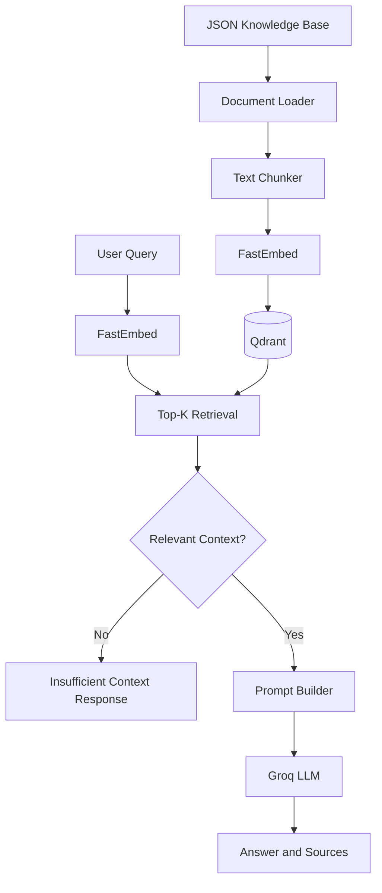

# GroundedQA

A basic Retrieval-Augmented Generation (RAG) pipeline built using Python, Groq, FastEmbed, and Qdrant.

The project loads documents from a JSON knowledge base, splits them into chunks, converts them into embeddings, and stores them in Qdrant. When a question is asked, it retrieves the most relevant chunks and passes them to Groq to generate a context-based answer.

## Tech Stack

- **Python** - Core implementation
- **Groq** - LLM-based answer generation
- **FastEmbed** - Local document and query embeddings
- **Qdrant** - Vector storage and similarity search
- **Pydantic / Dataclasses** - Data validation and structured objects
- **Pytest** - Unit testing
- **Docker** - Containerization
- **GitHub Actions** - CI and Docker image publishing

## How It Works

1. Load documents from the JSON knowledge base.
2. Validate the documents and split their content into smaller chunks.
3. Generate embeddings locally using FastEmbed.
4. Store the embeddings and document metadata in Qdrant.
5. Convert the user's question into an embedding.
6. Retrieve the Top-K most relevant chunks using cosine similarity.
7. Build a prompt using the retrieved context.
8. Send the prompt to Groq for answer generation.
9. Return the answer along with the retrieved source information.

If no relevant context is found, the pipeline returns an insufficient-context response instead of generating an unsupported answer.

## Architecture

